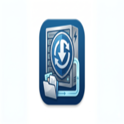
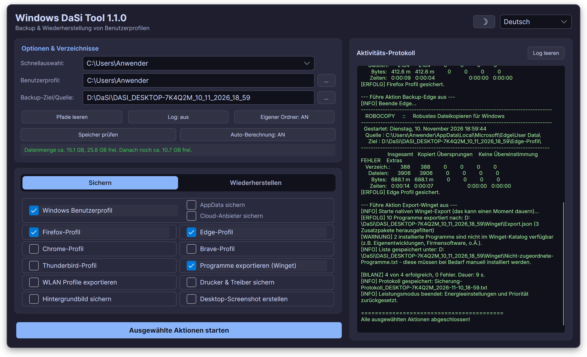
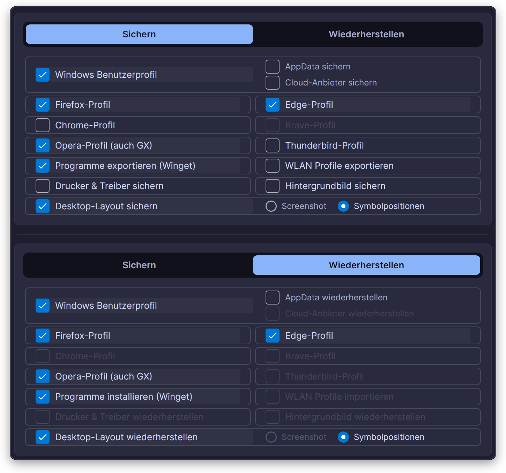
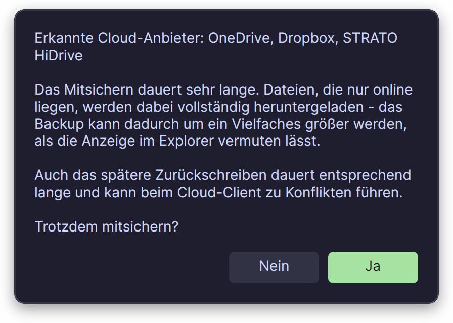
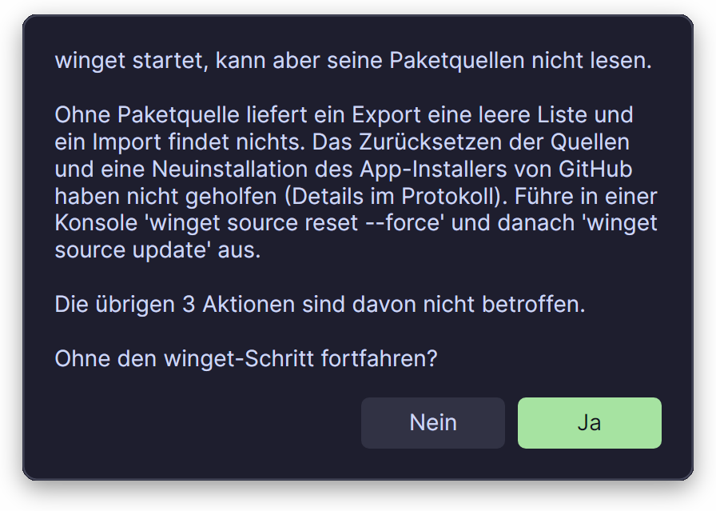
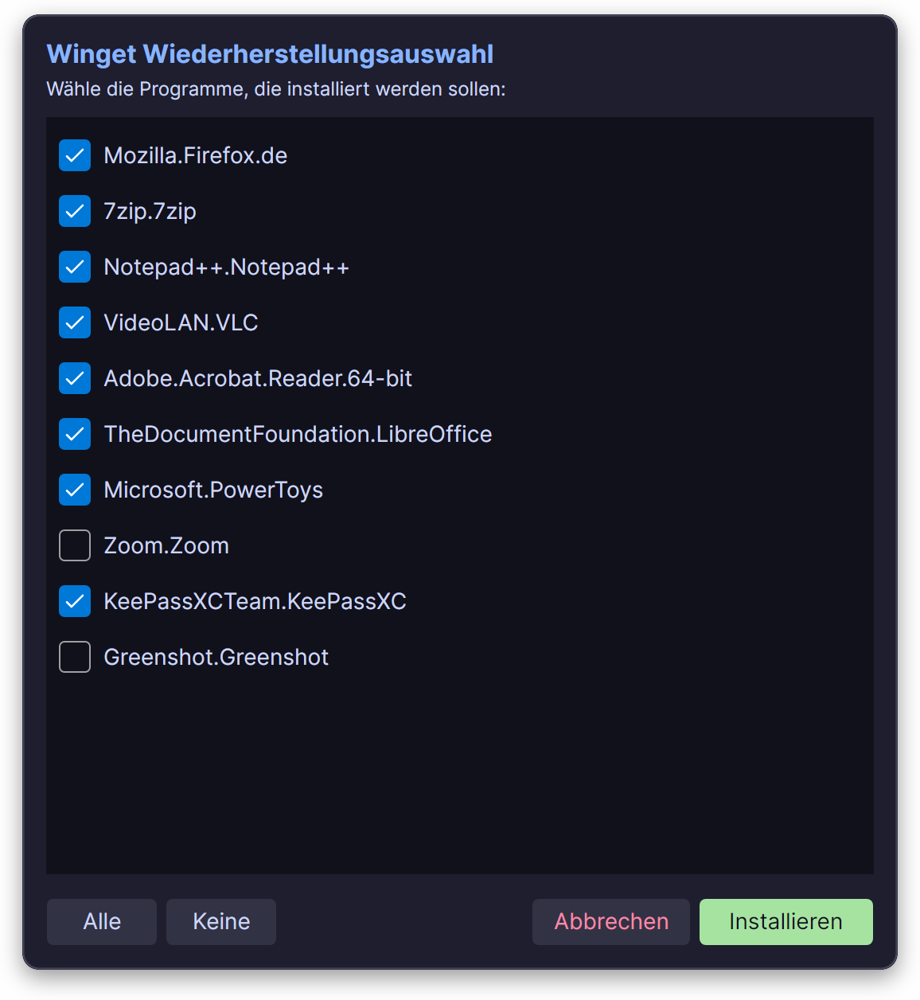
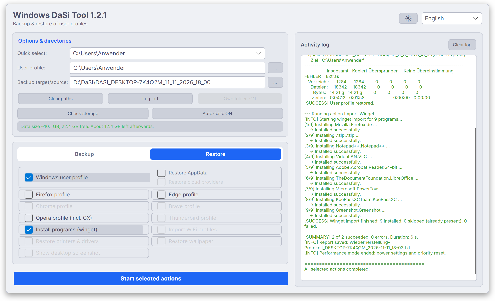

<div align="center">



# Windows DaSi Tool

**Datensicherung und Wiederherstellung von Windows-Benutzerprofilen — portabel, schnell, ohne Installation.**

[](https://github.com/Tinnitus97/Windows.DaSi.Tool/releases)
[](https://github.com/Tinnitus97/Windows.DaSi.Tool)
[](https://dotnet.microsoft.com/download/dotnet/10.0)
[](LICENSE)

</div>

---

Entwickelt für IT-Administratoren und Power-User. Das Tool vereint die Robustheit
von **Robocopy** mit einer modernen, zweisprachigen Oberfläche und sichert in einem
Durchgang Benutzerprofile, Browserdaten, installierte Programme, WLAN-Zugänge,
Drucker und das Hintergrundbild — und stellt sie auf dem neuen Rechner wieder her.
Ein Foto des Desktops hält fest, wo welche Symbole lagen.

<div align="center">

</div>

---

## Was das Tool sichert

| Bereich | Inhalt |
| --- | --- |
| **Windows-Benutzerprofil** | Dokumente, Bilder, Desktop, Downloads und alles Weitere im Profil. Zwischenspeicher, Temp-Ordner und Windows-Altlasten (Verknüpfungspunkte wie *Anwendungsdaten*) bleiben draußen. **AppData** und **Cloud-Ordner** wahlweise — Vorgabe: aus |
| **Browser-Profile** | Firefox, Edge, Chrome und Brave — inklusive Lesezeichen, Verlauf und Einstellungen |
| **E-Mail** | Thunderbird-Profil mit Konten und lokalen Ordnern |
| **Programme** | Export der installierten Software als Winget-Paketliste, Wiederherstellung mit Auswahldialog. Programme ohne Winget-Paket landen in einer eigenen Liste |
| **Netzwerk** | Export und Import gespeicherter WLAN-Profile inklusive Zugangsdaten |
| **Drucker** | Warteschlangen, Treiber, Ports und Einstellungen über PrintBRM in einer Datei |
| **Hintergrundbild** | Sichert das Desktop-Hintergrundbild und stellt es am Originalpfad wieder her |
| **Desktop-Anordnung** | Ein Foto des Desktops über alle Monitore — zeigt nach der Neuinstallation, wo welche Symbole lagen |

> **WLAN-Schlüssel liegen im Klartext in der Sicherung.** Damit sie auf einem anderen
> Rechner funktionieren, exportiert das Tool sie mit `key=clear` — verschlüsselt wären
> sie an den alten Rechner gebunden. Das Backup-Ziel deshalb wie ein
> Passwortverzeichnis behandeln.

---

## Highlights

### Ein Bereich, zwei Richtungen

Sichern und Wiederherstellen teilen sich eine Ansicht. Der Umschalter oben wechselt
die Richtung, die Beschriftungen passen sich automatisch an — aus *Programme
exportieren* wird *Programme installieren*, aus *Desktop-Screenshot erstellen* wird
*Desktop-Screenshot anzeigen*. Die Auswahl bleibt beim Umschalten erhalten.

<div align="center">

</div>

### AppData und Cloud-Ordner: bewusst entscheiden

Beide gehören zum Benutzerprofil, werden aber **nur auf ausdrücklichen Wunsch**
mitgenommen — die Haken sitzen direkt in der Profilkachel und sind nur aktiv, wenn
das Profil gewählt ist.

- **AppData** enthält Programmeinstellungen, aber auch maschinengebundene Lizenzen,
  Gerätekennungen und Anmeldesitzungen. Vor dem *Zurückschreiben* fragt das Tool
  deshalb nach. Zwischenspeicher wie `Temp`, `INetCache` und die Browser-Caches
  bleiben auch mit Haken draußen.
- **Cloud-Ordner** erkennt das Tool selbst: OneDrive (auch mit angehängtem
  Firmennamen wie *OneDrive - Muster GmbH*), Dropbox, Google Drive, iCloud, STRATO
  HiDrive, Nextcloud, ownCloud, MagentaCLOUD, pCloud, MEGA, Box, Tresorit, Seafile,
  Proton Drive, Jottacloud und Sync.com. Wer sie mitsichern will, bekommt vorher die
  gefundenen Anbieter genannt und eine Warnung: Dateien, die nur online liegen, werden
  dabei vollständig heruntergeladen.

Beide Schalter wirken in beide Richtungen: Ohne Haken wird AppData bzw. ein
Cloud-Ordner auch dann nicht zurückgeschrieben, wenn die Sicherung ihn enthält.

<div align="center">

</div>

### Desktop-Screenshot: Wo lag was?

Nach einer Neuinstallation ist der Desktop leer, und kaum jemand weiß noch, wo seine
Verknüpfungen lagen. Auf Wunsch fotografiert das Tool deshalb den Desktop — **alle
Monitore in einem Bild**, in ihrer echten Anordnung und in voller Auflösung, auch bei
skalierten Bildschirmen. Damit die Symbole frei liegen, blendet es dafür für einen
Moment alle Fenster aus (wie Win+D) und holt sie danach zurück.

Das Foto landet als `Desktop-Screenshot\Desktop.png` im Backup-Ziel. Beim
**Wiederherstellen** öffnet derselbe Punkt dieses Foto, damit sich die Symbole danach
von Hand anordnen lassen — automatisch zurückstellen lässt sich die Anordnung nicht
verlässlich, der Explorer überschreibt sie mit seinem eigenen Stand.

> Fotografiert wird, was auf dem Bildschirm zu sehen ist. Ist ein anderer Benutzer
> angemeldet als der, dessen Profil gesichert wird — etwa der Techniker —, macht das
> Tool kein Foto und sagt das im Protokoll: Es zeigte den falschen Desktop.

### Speicherprüfung mit Ampel

Noch vor dem Start schätzt das Tool die Datenmenge — mit genau denselben
Ausschlüssen wie beim Kopieren — und vergleicht sie mit dem freien Platz am Ziel,
inklusive 10 % Reserve:

| Anzeige | Bedeutung |
| --- | --- |
| 🟢 grün | passt, mit Angabe, wie viel danach frei bleibt |
| 🟡 gelb | passt, aber knapp |
| 🔴 rot | reicht nicht — mit Angabe, wie viel fehlt |

Bei eingeschalteter *Auto-Berechnung* rechnet das Tool nach jeder Änderung der
Auswahl neu. Eine laufende Berechnung wird dabei abgebrochen und mit dem neuen Stand
wiederholt.

### Winget: erst prüfen, dann arbeiten

Vor jedem Export und jedem Import prüft das Tool, ob winget **startet** *und* ob
seine **Paketquelle antwortet** — „vorhanden“ heißt noch nicht „funktionsfähig“.
Fehlt etwas, kommt die Meldung vor der ersten Kopie und nicht nach zwanzig Minuten
Profilsicherung, mit dem konkreten Weg zur Behebung. Stehen weitere Aktionen an,
lässt sich der winget-Schritt überspringen, ohne den Rest zu verlieren.

<div align="center">

</div>

Beim **Export** wird die Liste um Zusatz- und Laufzeitpakete bereinigt (etwa die
Visual-C++-Laufzeiten); Programme, die es bei Winget nicht gibt — Firmensoftware,
Eigenentwicklungen —, landen in `Winget\Nicht-zugeordnete-Programme.txt`. Eine
vorhandene Liste wird erst ersetzt, wenn die neue vollständig ist.

Beim **Wiederherstellen** wird gezielt ausgewählt, was installiert werden soll:

<div align="center">

</div>

### Schnellauswahl der Benutzerprofile

Alle echten Profile unter `C:\Users` stehen im Dropdown bereit. System- und
Dienstprofile werden automatisch herausgefiltert, sodass nur relevante Konten
erscheinen.

### Zweisprachig und mit Hell-/Dunkelmodus

Die gesamte Oberfläche inklusive Aktivitätsprotokoll lässt sich zwischen
**Deutsch** und **Englisch** umschalten. Sprache und Farbschema werden beim Start
aus den Windows-Einstellungen übernommen und lassen sich jederzeit über das
Sonne-/Mond-Symbol und das Sprach-Dropdown ändern.

<div align="center">

</div>

### Nachvollziehbares Protokoll und ehrliche Bilanz

Jeder Schritt wird in Echtzeit protokolliert. Das Protokoll scrollt automatisch mit,
hält aber an, sobald man zum Nachlesen nach oben scrollt. Mit **Log: an** erscheint
zusätzlich die vollständige Robocopy-Ausgabe Datei für Datei.

Am Ende steht eine Bilanz — *4 von 4 erfolgreich, 0 Fehler* —, und dieselbe Übersicht
landet als Datei im Backup-Ziel: `Sicherung-Protokoll_<Rechner>_<Datum>.txt` bzw.
`Wiederherstellung-Protokoll_…`. Eine Aktion zählt nur dann als erfolgreich, wenn sie
ohne einen einzigen Fehler durchlief.

### Für lange Sicherungen gerüstet

- Läuft ein Notebook im **Akkubetrieb**, warnt das Tool vor dem Start und fragt nach.
- Während des Laufs geht der Rechner **nicht in den Standby**, und das Tool arbeitet
  mit erhöhter Priorität. Beides wird danach vollständig zurückgesetzt — an den
  Energieeinstellungen von Windows ändert sich nichts.
- Browser und Thunderbird werden vor dem Kopieren **automatisch geschlossen**, damit
  keine Datei mitten im Schreiben gesichert wird.

---

## Selbstaktualisierung

Beim Start holt das Programm **eine** Datei:

```
https://raw.githubusercontent.com/Tinnitus97/Windows.DaSi.Tool/HEAD/update.json
```

Gibt es eine neuere Fassung, erscheint über dem Protokoll ein gelber Streifen
mit zwei Schaltflächen — **Was ist neu?** und **Jetzt aktualisieren**. Gibt es
nichts, bleibt er unsichtbar.

**Heruntergeladen und ersetzt wird nichts ohne Rückfrage.** Vor dem Austausch
wird die **SHA256-Summe** der geladenen Datei mit der Angabe aus `update.json`
verglichen; stimmt sie nicht, wird die Datei verworfen.

Eine laufende EXE kann sich unter Windows nicht selbst überschreiben. Deshalb
schreibt das Programm ein kleines Skript nach `%TEMP%\WindowsDaSiTool-Update`,
das die Datei ersetzt, sobald sich das Programm beendet hat, und die neue Fassung
startet. Schlägt das fehl — fehlende Schreibrechte, oder das Programm läuft anderswo
aus demselben Ordner —, öffnet sich eine Erklärung mit beiden Pfaden im Editor, und
die bisherige Fassung startet wieder. Umlaute im Benutzernamen (`C:\Users\Jürgen`)
sind kein Hindernis.

> **Umstieg von 1.0.x auf 1.1.0:** Diesen einen Austausch erledigt noch das
> Austauschskript der alten Fassung. Das Programm braucht dabei rund eine Minute, bis
> es neu startet. Bei einem **Umlaut im Benutzernamen** scheitert das alte Skript —
> dort die neue EXE einmal von Hand aus den
> [Releases](https://github.com/Tinnitus97/Windows.DaSi.Tool/releases) holen. Ab 1.1.0
> ist beides behoben.

Für ein internes Spiegelverzeichnis lässt sich in `Update-Url.txt` **neben der
EXE** eine abweichende Adresse hinterlegen — eine Zeile, vollständige
`https://…`-Adresse.

> Warum nicht `api.github.com`? Die Schnittstelle erlaubt ohne Anmeldung nur 60
> Abrufe je Stunde und IP-Adresse — in einer Firma sitzen alle Rechner hinter
> derselben Adresse. `raw.githubusercontent.com` kennt diese Grenze nicht.

Wie eine neue Fassung veröffentlicht wird — im Browser, in GitHub Desktop oder
auf der Kommandozeile — steht in **[docs/VEROEFFENTLICHEN.md](docs/VEROEFFENTLICHEN.md)**.

---

## Systemanforderungen

| Anforderung | Details |
| --- | --- |
| **Betriebssystem** | Windows 10 oder Windows 11 (64 Bit) |
| **Berechtigungen** | Administratorrechte — die UAC-Abfrage erfolgt automatisch beim Start |
| **Dateisystem** | Das Backup-Ziel muss auf einem **NTFS**-Laufwerk liegen (Robocopy-Voraussetzung) |
| **.NET** | Nicht erforderlich — die Laufzeit ist in der EXE enthalten |
| **Winget** | Nur für *Programme exportieren/installieren*: der *App-Installer* aus dem Microsoft Store (unter Windows 11 vorinstalliert) |

---

## Nutzung

1. Aktuelle `WindowsDaSiTool.exe` aus dem [Releases-Bereich](https://github.com/Tinnitus97/Windows.DaSi.Tool/releases) herunterladen.
2. EXE starten und die UAC-Abfrage mit **Ja** bestätigen.
3. Über die **Schnellauswahl** das Benutzerprofil wählen (oder per `...` manuell suchen).
4. Das **Backup-Ziel** festlegen — ein Ordner auf einem NTFS-Laufwerk.
5. Modus **Sichern** oder **Wiederherstellen** wählen und die gewünschten Punkte ankreuzen.
   *AppData* und *Cloud-Anbieter* nur bei Bedarf dazunehmen.
6. Auf die **Speicherzeile** achten: Grün heißt, der Platz reicht.
7. **Ausgewählte Aktionen starten** — der Fortschritt erscheint im Protokoll, die
   Bilanz am Ende zusätzlich als Datei im Backup-Ziel.

> **Hinweis zu Passwörtern:** Gespeicherte Browser-Passwörter sind im Profil-Backup
> verschlüsselt enthalten und funktionieren nach der Wiederherstellung auf demselben
> Rechner und Benutzerkonto wieder. Für einen Wechsel auf einen anderen Rechner nutze
> den Export-Dialog des jeweiligen Browsers (z. B. `edge://settings/passwords`).

---

## Technische Details

| | |
| --- | --- |
| **Sprache** | C# |
| **UI-Framework** | [Avalonia](https://avaloniaui.net/) 12.1 |
| **Zielplattform** | .NET 10 (LTS), `win-x64`, self-contained |
| **Dateioperationen** | Robocopy mit Spiegelung, Ausschlusslisten und Multithreading |
| **Prozess-Handling** | Browser und Thunderbird werden vor dem Backup automatisch geschlossen, um Dateikonflikte zu vermeiden |
| **Fehlerbehandlung** | Unerwartete Fehler landen in `%USERPROFILE%\Desktop\WindowsDaSiTool_Absturz.log` |
| **Prüfungen** | `tests/DaSiTests` — Ausschlusslisten, Cloud-Erkennung, Bilanz, Update-Logik. Läuft bei jedem Push unter Linux und Windows; unter Windows wird das Austauschskript der Selbstaktualisierung dabei echt ausgeführt |

### Selbst bauen

Voraussetzung ist das [.NET 10 SDK](https://dotnet.microsoft.com/download/dotnet/10.0).

```powershell
git clone https://github.com/Tinnitus97/Windows.DaSi.Tool.git
cd Windows.DaSi.Tool
.\build.ps1
```

Die fertige EXE liegt anschließend im Ordner `publish`.

| Parameter | Wirkung |
| --- | --- |
| `.\build.ps1` | Self-contained Build (Standard) — läuft ohne installiertes .NET |
| `.\build.ps1 -Mode framework` | Deutlich kleinere EXE, setzt .NET 10 Desktop Runtime voraus |
| `.\build.ps1 -Sign` | Signiert die EXE, um SmartScreen-Warnungen zu reduzieren |

Die Prüfungen laufen ohne Oberfläche und auf jedem System:

```powershell
dotnet run --project tests/DaSiTests -c Release
```

---

## Hinweis zu SmartScreen

Die EXE ist nicht mit einem kostenpflichtigen Zertifikat signiert. Windows zeigt
beim ersten Start daher möglicherweise eine SmartScreen-Warnung. Über
**Weitere Informationen → Trotzdem ausführen** lässt sie sich starten. Wer die
Warnung vermeiden möchte, kann das Projekt selbst bauen und mit einem eigenen
Zertifikat signieren.

---

## Changelog

Alle Änderungen sind in der [CHANGELOG.md](CHANGELOG.md) dokumentiert.

---

## Lizenz

Dieses Projekt steht unter der [MIT-Lizenz](LICENSE).
